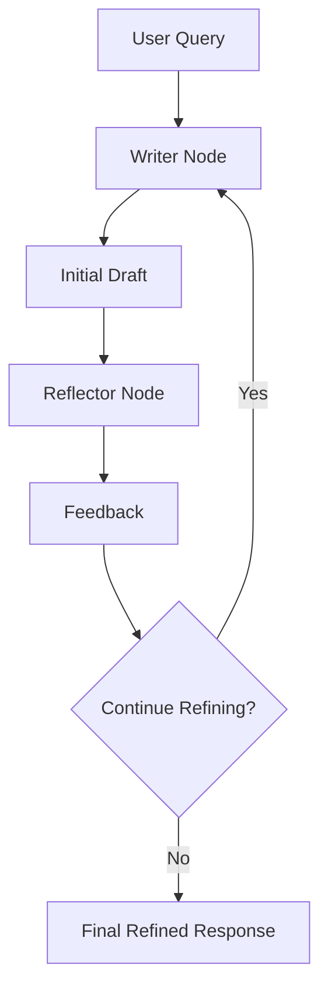

# ✍️ Agentic Content Refiner

An AI-powered writing agent that uses **reflection and iterative refinement** to improve generated content. Instead of producing a response in a single pass, the agent creates an initial draft, evaluates it, receives feedback, and refines the content through a repeated writing and reflection loop.

Built with LangChain and LangGraph, this project explores how self-reflective agent workflows can improve the quality of AI-generated content.

## ✨ Features

- **Draft Generation:** Generates an initial draft based on the user's query.
- **Reflection-Based Feedback:** Evaluates the draft and identifies areas for improvement.
- **Iterative Refinement:** Repeats the writing and reflection process for a configurable number of iterations.
- **Dedicated Writer Node:** Creates and revises content based on the original request and reflection feedback.
- **Dedicated Reflector Node:** Reviews the draft and provides actionable feedback.
- **Workflow Orchestration:** Uses LangGraph to manage the interaction between the writer and reflector nodes.
- **Debugging and Observability:** Uses Langfuse to help inspect and debug agent execution.

## 🧠 How It Works

The agent follows a write → reflect → refine workflow.

1. **User Query:** The user submits a request describing the content they want.
2. **Writer Node:** The writer generates an initial draft based on the query.
3. **Reflector Node:** The reflector evaluates the draft and provides feedback on areas that need improvement.
4. **Refinement Loop:** The writer uses the feedback to revise the draft. The updated draft is sent back to the reflector for another evaluation.
5. **Iteration Control:** The process continues for the configured number of iterations or until the workflow's stopping condition is met.
6. **Final Response:** The workflow returns the refined draft to the user.

## 🏗️ System Architecture

The writer and reflector have distinct responsibilities. The writer focuses on generating and improving content, while the reflector evaluates the current draft and identifies improvements. LangGraph coordinates the loop and controls when the workflow finishes.

## 🔄 Reflection-Based Agent Workflow

### Writer Node

The writer node generates content from the user's original query. During subsequent iterations, it also uses the reflector's feedback to improve the existing draft rather than starting without context.

### Reflector Node

The reflector node reviews the generated draft and provides feedback intended to improve its quality, relevance, clarity, and alignment with the user's request.

### Iterative Improvement

The key idea is that content generation is not treated as a one-shot operation. Each iteration gives the writer another opportunity to address weaknesses identified during reflection.

This pattern separates **content generation** from **content evaluation**, making the workflow easier to reason about, debug, and extend.

## 🛠️ Tech Stack

| Technology | Purpose |
|---|---|
| **Bun** | Runtime and package management |
| **TypeScript** | Type-safe application development |
| **LangChain** | LLM integration and supporting agent components |
| **LangGraph** | Writer-reflector workflow orchestration and iteration control |
| **Langfuse** | Observability, tracing, and debugging of LLM workflows |

## 🔍 Observability with Langfuse

Langfuse helps inspect the agent's execution across the writing and reflection stages.

It can be used to trace LLM calls, investigate workflow behavior, and understand how drafts and feedback evolve across iterations, depending on the tracing instrumentation configured in the project.

## 🎯 Project Goal

The goal of this project is to explore **reflection as a design pattern for AI agents**.

By combining a writer node with a reflector node in an iterative workflow, the project demonstrates how AI-generated content can be reviewed and refined through structured feedback rather than relying on a single generation step.

